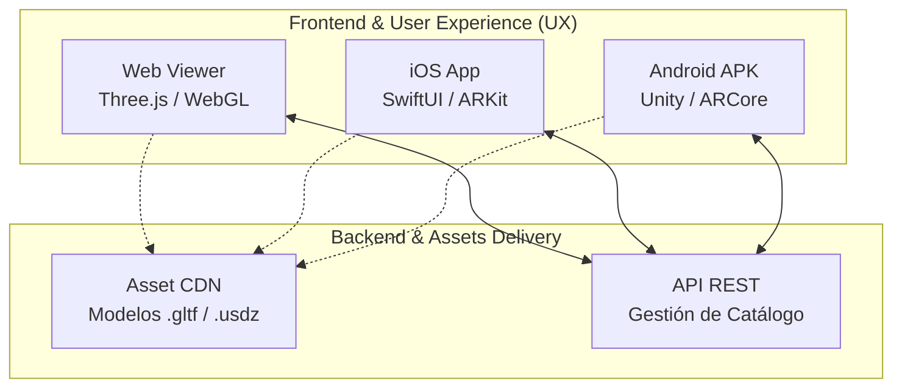

# Ecosistema Completo de Diseno 3D (Mobiliario y Retail)

> **Plataforma omnicanal (iOS, Android, Web) orientada a la previsualización, diseño y renderizado de mobiliario y productos en 3D.**

---

## Executive Overview

Diseñado para revolucionar la experiencia de usuario (UX) en el sector Retail (como calzado, complementos o mobiliario), este ecosistema permite visualizar productos interactivos en tres dimensiones antes de su fabricación o compra. 

Ideal para roles de **Product Building y Diseño**, acorta el ciclo de prototipado y mejora la tasa de conversión en ecommerce al ofrecer integración de modelos 3D directamente en el navegador y en dispositivos móviles.

---

## System Architecture

---

## Tech Stack
* **Web 3D:** Three.js, WebGL
* **Móvil:** SwiftUI (iOS), APK nativo (Android)
* **Modelos Soportados:** `.gltf`, `.glb`, `.usdz`
* **Enfoque de Producto:** Omnicanalidad y Experiencia de Usuario (UX)
