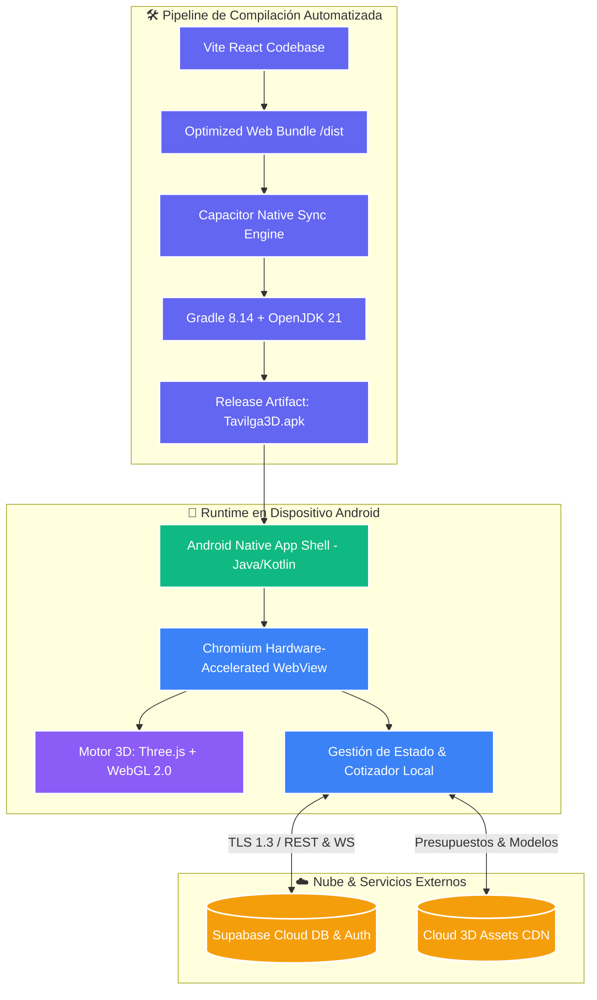

# Tavilga 3D Mobile - Android Distribution & Runtime Architecture

[]()
[]()
[]()
[]()
[]()

## 📌 Resumen Ejecutivo
**Tavilga 3D Mobile** representa la extensión móvil nativa de alta fidelidad del configurador paramétrico de mobiliario. Empaqueta el motor de renderizado 3D reactivo (React Three Fiber / WebGL 2.0) dentro de un contenedor nativo ultraligero de **Capacitor 7**, optimizado con aceleración de hardware en GPU móvil y gestión eficiente de memoria RAM para entornos B2B y B2C en movilidad.

Este repositorio alberga la ingeniería de empaquetado, la arquitectura de ejecución y el pipeline de compilación de binarios Android (APKs / AABs) orientados a distribución empresarial.

---

## 🏗️ Arquitectura de Ejecución Móvil y Pipeline (Mermaid)



---

## 📚 Estructura Estándar del Entorno de Distribución

```text
Diseno 3D APK/
├── dist/                   # Artefactos web compilados y cacheados
├── release/                # Metadatos de firma y verificación de integridad
├── .gitkeep                # Control de estructura de directorios
└── README.md               # Documentación ejecutiva de ingeniería y despliegue
```

---

## 🔐 Especificaciones Técnicas y de Seguridad

| Dimensión | Especificación Enterprise |
| :--- | :--- |
| **Arquitectura de Runtime** | Hybrid Native Container (Capacitor v7.x) |
| **API Level Objetivo** | Android 14+ (Target SDK 34 / Compatible SDK 36) |
| **Toolchain de Compilación** | Gradle 8.14.3 + Microsoft OpenJDK 21 (HotSpot) |
| **Aceleración Gráfica** | WebGL 2.0 con Context Loss Recovery y Mipmapping dinámico |
| **Seguridad de Red** | HTTPS forzado mediante esquema seguro nativo (`androidScheme: "https"`) |
| **Gestión de Memoria** | Texturas comprimidas y Garbage Collection optimizado para 3D en smartphones |