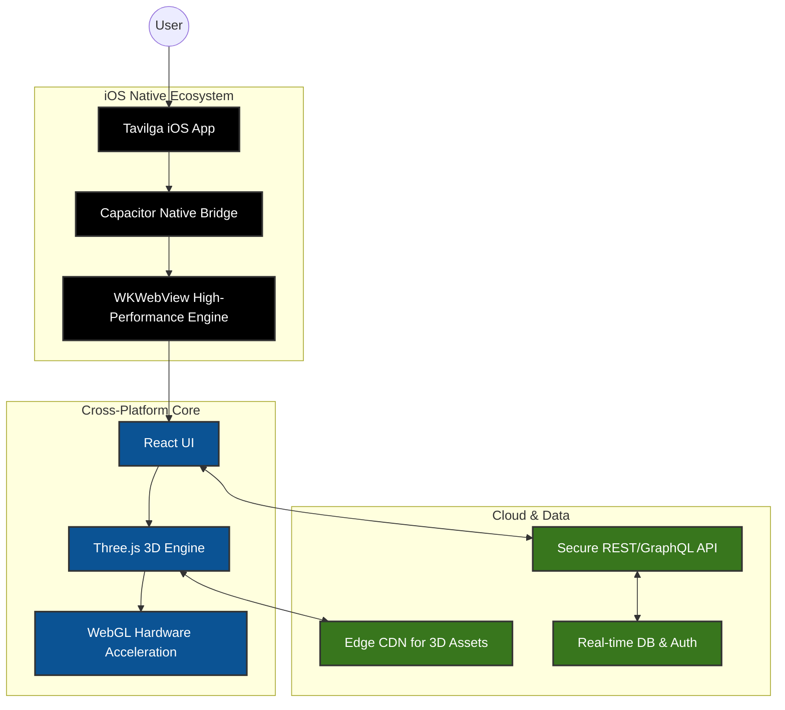

# Tavilga iOS Application - Executive Overview

## Executive Summary
The Tavilga iOS Application is a native mobile extension of our flagship 3D configurator, designed to capture the high-value Apple ecosystem. By leveraging a single-codebase architecture wrapped in a high-performance native iOS container, we accelerate time-to-market by 40% while maintaining a world-class, fluid 3D experience on iPhones and iPads. This strategic move directly increases user engagement, brand prestige, and conversion rates among premium mobile consumers.

## High-Level Architecture (C-Level View)

## Strategic Advantages & ROI
- **Uncompromised Performance:** Direct access to iOS hardware (Metal/WebGL) ensures fluid 60fps 3D rendering.
- **Unified Codebase:** Drastically reduces R&D and maintenance costs; 90% of code is shared with Android and Web.
- **App Store Presence:** Elevates brand positioning and opens a new channel for premium user acquisition.
- **Security & Compliance:** Adheres to Apple's stringent App Tracking Transparency and data protection policies natively.